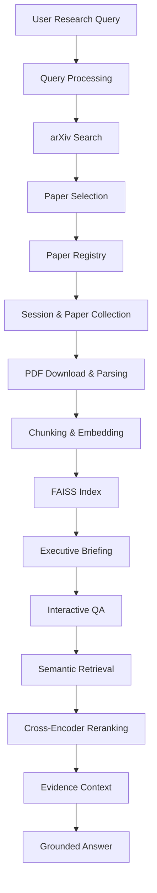
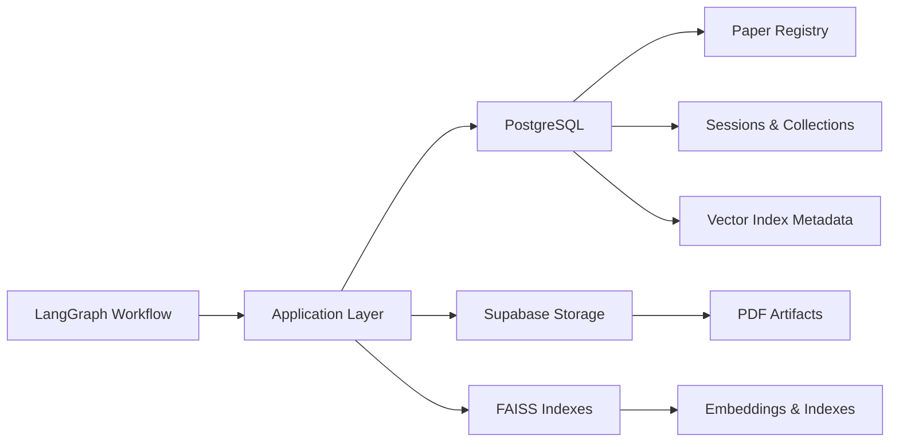

# arXiv Paper Digest & QA Agent

A session-based research assistant for multi-paper research and evidence-grounded question answering over arXiv papers. Built with **FastAPI, LangGraph, RAG, and FAISS**, the project focuses on retrieval quality, persistent research artifacts, and modular backend architecture.

**V2 is under active development.**

[Repository](https://github.com/5ammy29/arxiv-agent) · [V2 Branch](https://github.com/5ammy29/arxiv-agent/tree/v2)

---

## Overview

The arXiv Agent processes research papers and enables users to ask questions grounded in their content. V2 extends the original single-paper workflow toward session-based, multi-paper research with persistent storage and caching.

The system combines semantic retrieval with Cross-Encoder reranking to improve the relevance of evidence supplied to the language model.

## Features

- **Multi-Paper Research:** Supports research workflows involving multiple arXiv papers.
- **Session-Based Research:** Associates papers and research context with individual sessions.
- **Evidence-Grounded QA:** Generates answers using retrieved paper content.
- **Semantic Retrieval:** Embedding-based retrieval using FAISS.
- **Cross-Encoder Reranking:** Refines retrieved evidence rankings.
- **Paper Registry:** Tracks papers using canonical arXiv identifiers and versions.
- **Persistent Storage:** Integrates PostgreSQL and Supabase Storage for research artifacts.
- **Stateful Workflow Orchestration:** Uses LangGraph to coordinate query processing, paper retrieval, document processing, and answer generation.
- **Modular Architecture:** Separates graph orchestration, application logic, processing, and infrastructure.

---

## Architecture

The system uses LangGraph for workflow orchestration, with application and infrastructure layers handling paper processing, retrieval, and persistence.

### Research Workflow



### Persistence Architecture



---

## Retrieval Evaluation

Retrieval performance is evaluated across four datasets containing **200 questions**. Baseline retrieval is compared against retrieval with a Cross-Encoder reranker.

### Mean Reciprocal Rank (MRR)

| Dataset | Questions | Baseline MRR | Reranked MRR | Improvement |
|---|---:|---:|---:|---:|
| Single-paper | 80 | 68.85% | 79.57% | +10.73 pp |
| Multi-paper | 50 | 71.30% | 87.14% | +15.83 pp |
| Numerical evidence-specific | 40 | 42.07% | 44.46% | +2.39 pp |
| Architecture & methodology | 30 | 39.81% | 48.26% | +8.44 pp |

*Metrics are macro-averaged across questions. Improvements are expressed in percentage points.*

### Key Results

- Improved multi-paper retrieval MRR by **15.83 percentage points**, from 71.30% to 87.14%.
- Improved single-paper retrieval MRR by **10.73 percentage points**, from 68.85% to 79.57%.
- Achieved MRR improvements across all four evaluation datasets.
- Evaluated retrieval across single-paper, multi-paper, numerical evidence, and architecture/methodology questions.

Reranking does not improve every metric at every cutoff. Multi-paper Recall@5 and Recall@10 decrease in the reranked setting.

*This benchmark evaluates retrieval quality. Answer-generation quality is not included.*

For additional retrieval evaluation metrics and detailed benchmark results, see [`data/eval/report.md`](https://github.com/5ammy29/arxiv-agent/blob/v2/data/eval/qwen/report.md) on the `v2` branch.

---

## Tech Stack

| Component | Technology |
|---|---|
| Language | Python 3.12 |
| API Framework | FastAPI |
| Agent Orchestration | LangGraph |
| LLM | Ollama / Qwen2.5:3B |
| Embeddings | Sentence Transformers |
| Vector Search | FAISS |
| Reranking | Cross-Encoder |
| Database | PostgreSQL |
| Object Storage | Supabase Storage |
| PDF Processing | PyMuPDF |
| Data Validation | Pydantic |
| Testing | pytest |
| Containerization | Docker |

---

## Project Structure

```text
arxiv-agent/
├── project/
│   ├── application/
│   │   ├── papers/
│   │   └── retrieval/
│   ├── graph/
│   │   ├── __init__.py
│   │   ├── nodes.py
│   │   ├── state.py
│   │   └── workflow.py
│   ├── infrastructure/
│   │   ├── database/
│   │   └── storage/
│   ├── processing/
│   │   ├── pdf.py
│   │   └── chunker.py
│   └── api/
├── frontend/
├── benchmarks/
├── deploy/
├── tests/
├── supabase/
│   └── migrations/
└── README.md
```

*The structure reflects the V2 architectural organization.*

---

## Engineering Focus

V2 emphasizes:

- **Persistent Artifact Management:** Storing and reusing processed paper artifacts.
- **Session Isolation:** Maintaining research context and paper collections across sessions.
- **Reproducibility:** Tracking papers using canonical arXiv identifiers and versions.
- **Retrieval Quality:** Evaluating semantic retrieval and reranking across diverse question categories.
- **Modularity:** Separating graph orchestration from application logic and infrastructure.
- **Storage Integration:** Using PostgreSQL and Supabase Storage for persistent research data.

---

## Development

V2 development is maintained on the [`v2` branch](https://github.com/5ammy29/arxiv-agent/tree/v2).

The `main` branch contains the project documentation, while the V2 implementation is maintained separately.